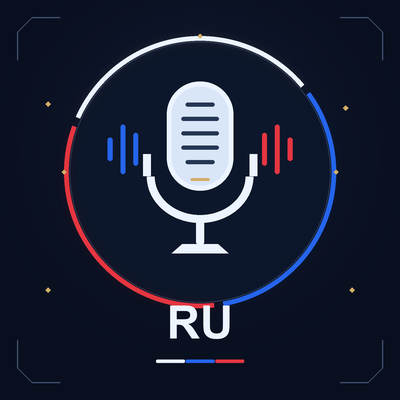

# Prominence II — русская озвучка

Русская AI-озвучка, заменяющая 57 диалоговых записей персонажей в Prominence II: Hasturian Era.

> **Статус: репозиторий документации.** Здесь — документация, оформление и воспроизводимые инструменты.
> Аудиофайлы тут не публикуются. Распространение аудио требует разрешения автора оригинала
> (см. [права и лицензия](#права-и-лицензия) и [THIRD_PARTY_NOTICES.md](THIRD_PARTY_NOTICES.md)).

[Read in English](README.md) · **Версия:** v1.0.0 · **Игра:** Minecraft 1.20.1 (Fabric) · **Сборка:** Prominence II: Hasturian Era v4.1.2

## Что это

Ресурспак русской озвучки сюжетных диалогов Prominence II: Hasturian Era:

- **57 диалоговых записей** — 6 персонажей: Радин (8), С'келлак (23), Гумас (4), Хастур (5), Алм (6), Миргафф (11)
- **Формат:** OGG Vorbis, 48 кГц моно, оригинальные пути и имена файлов сохранены
- **Метаданные пака:** `pack_format` 15 (Minecraft 1.20.1), чистый `pack.mcmeta`, свой `pack.png`
- Все 57 файлов декодируются, сопоставлены событиям звука мода 1:1, длительности совпадают с оригиналом в пределах ~1%

## Установка

Подробно: [docs/INSTALLATION.md](docs/INSTALLATION.md).

1. Возьми ZIP войспака (`Prominence_II_Russian_Voice_Pack_Final.zip`, v1.0.0) из канала релиза.
2. Скопируй его в `minecraft/resourcepacks/`.
3. Включи его верхним в списке ресурспаков.
4. Отключи другие войспаки, чтобы не было наложений.
5. Откат: выключи пак — мод JAR вернёт оригинальные английские голоса.

## Совместимость

См. [docs/COMPATIBILITY.md](docs/COMPATIBILITY.md). Кратко: Minecraft 1.20.1 / Fabric,
Prominence II: Hasturian Era v4.1.2, неймспейс `prominent`, без переопределения `sounds.json`, музыка и эффекты не тронуты.

## Проверка

Каждый выпущенный файл прошёл: сопоставление имя/событие/путь 57/57, декодирование FFmpeg 57/57, SHA-256 манифест.
Детали: [docs/VERIFICATION.md](docs/VERIFICATION.md).

## Права и лицензия

Неофициальная AI-локализация сообщества. **Не игра оригинальных актёров и не официальный релиз.**
Оригинальный контент мода: Cinderstone Studios / ElocinDev. См. [LICENSE](LICENSE) и
[THIRD_PARTY_NOTICES.md](THIRD_PARTY_NOTICES.md). Публичное распространение аудио требует разрешения —
не перезаливай записи без него.
